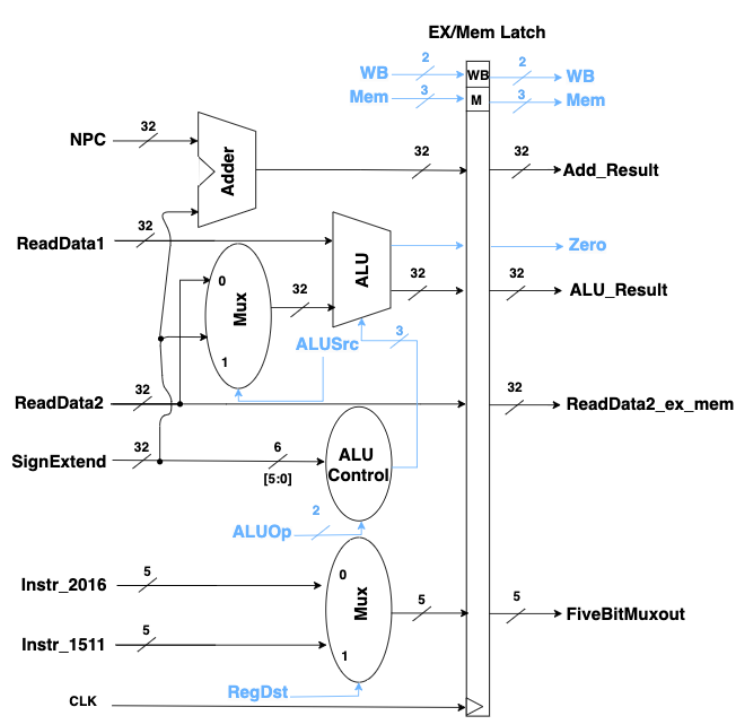
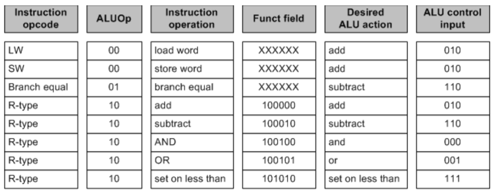

# Coding Assignment 3 — Execute Stage
<!--
Replace every item in square brackets before submitting.
Keep this README focused on what the design does, how it is used, and how it was
verified.
-->
## Design Scope and Assumptions
- **In scope:** The execute stage of the MIPS pipeline takes the operands and control bits from the ID/EX latch, performing the arithmetic or logic operation in the ALU, computing the branch target address, selecting the destination register number, and storing results in the EX/MEM latch.
- **Out of scope:** Future stages (MEM & WB) as well as hazard handling will be implemented in later labs.
- **Assumptions:** 32-bit data and addresses. The ALU, ALU control, muxes, and branch adder are combinational. Only the EX/MEM latch is clocked, on the rising clock edge. ALU control follows Fig. 2 in the images folder.
- **Limitations:** The ALU supports add, subtract, AND, OR, and set-on-less-than. Invalid ALUOp combinations produce select 011, and the ALU outputs unknown XXX values for any invalid select code.
  
## Requirements
| Requirement | Description | Verification Method |
|---|---|---|
| REQ-01 | [The design shall ...] | [Test case, waveform, calculation, or
inspection] |
| REQ-02 | [The design shall ...] | [Test case, waveform, calculation, or
inspection] |
| REQ-03 | [The design shall ...] | [Test case, waveform, calculation, or
inspection] |

## Architecture
### Timing or Behavioral Summary
DESCRIPTION



## Implementation
### Source Code
| File | Description |
|---|---|
| [`alu.v`](https://github.com/Spindoza23/codingAssignment3-IE/blob/main/alu.v) | Performs add, subtract, AND, OR, and set-on-less-than on two 32-bit inputs, and outputs the results and the zero flag |
| [`alu_control.v`](https://github.com/Spindoza23/codingAssignment3-IE/blob/main/alu_control.v) | Converts ALUOp and the function field into the ALU select code |
| [`adder.v`](https://github.com/Spindoza23/codingAssignment3-IE/blob/main/adder.v) | Branch adder  |
| [`top_mux.v`](https://github.com/Spindoza23/codingAssignment3-IE/blob/main/top_mux.v) | Uses ALUSrc to select between SignExtend and ReadData2 to send to the ALU as its second operand |
| [`bottom_mux.v`](https://github.com/Spindoza23/codingAssignment3-IE/blob/main/bottom_mux.v) | Implements a multiplexer that selects from two inputs (5 bits), a and b, based on the select input (sel) |
| [`ex_mem_latch.v`](https://github.com/Spindoza23/codingAssignment3-IE/blob/main/alu.v) | This is the latch that receives signals form all the modules of the execute stage. Its outputs go to MEM/WB and FETCH.|
| [`execute.v`](https://github.com/Spindoza23/codingAssignment3-IE/blob/main/execute.v) | [Verification testbench] |
| [`alu_tb.v`](https://github.com/Spindoza23/codingAssignment3-IE/blob/main/alu_tb.v) | Testbench for the ALU |
| [`alu_control_tb.v`](https://github.com/Spindoza23/codingAssignment3-IE/blob/main/alu_control_tb.v) | Testbench for the ALU control |
| [`execute_tb.v`](https://github.com/Spindoza23/codingAssignment3-IE/blob/main/execute_tb.v) | Testbench for the full execute stage |

### Implementation Notes
- [Explain one important design decision.]
- [Identify any parameterization, reusable module, or interface convention.]
- [Document any deliberate simplification made for this lab.]

## Verification
### Verification Strategy
The design is verified using **[simulation, formal checks, hardware testing, or
another method]**.
Verification covers:
- [Normal operating case]
- [Boundary or maximum-value case]
- [Reset or initialization case]
- [Invalid, stalled, or exceptional case, if applicable]
### Testbench and Waveform
Save screenshots and waveform images in the repository's `images/` folder.

The testbench source is available [*here*](LINK_TO_TESTBENCH_CODE).
### Results
| Test Case | Expected Result | Observed Result | Status |
|---|---|---|---|
| TC-01 — [Name] | [Expected behavior] | [Observed behavior] | Pass / Fail |
| TC-02 — [Name] | [Expected behavior] | [Observed behavior] | Pass / Fail |
| TC-03 — [Name] | [Expected behavior] | [Observed behavior] | Pass / Fail |

## Reproduction Instructions
### Tools and Versions
- **Simulator / synthesis tool:** Vivado
- **Language / standard:** Verilog
- **Operating system:** Windows
- **Additional dependencies:** n/a
### Build and Run
```bash

```
Expected output:
```text
[Paste a short representative output or result here.]
```

## Repository Organization
```text
.
├── README.md
├── images/
│ ├── [timing-diagram-filename].png
│ └── [testbench-screenshot-filename].png
├── [source-files]
└── [testbench-files]
```
## Known Issues and Future Improvements
- [Document any known issue, unverified behavior, or technical debt.]
- [Describe a realisti
