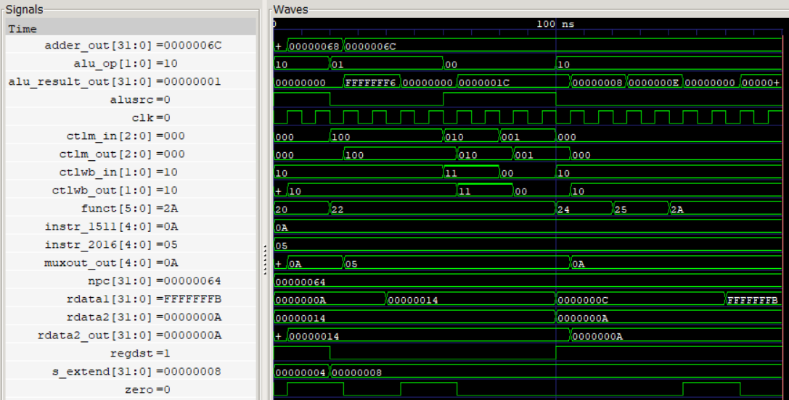

# Coding Assignment 3 — Execute Stage
<!--
Replace every item in square brackets before submitting.
Keep this README focused on what the design does, how it is used, and how it was
verified.
-->
## Design Scope and Assumptions
- **In scope:** The execute stage of the MIPS pipeline takes the operands and control bits from the ID/EX latch, performing the arithmetic or logic operation in the ALU, computing the branch target address, selecting the destination register number, and storing results in the EX/MEM latch.
- **Out of scope:** Future stages (MEM & WB) as well as hazard handling will be implemented in later labs.
- **Assumptions:** 32-bit data and addresses. The ALU, ALU control, muxes, and branch adder are combinational. Only the EX/MEM latch is clocked, on the rising clock edge. ALU control follows Fig. 2 in the images folder.
- **Limitations:** The ALU supports add, subtract, AND, OR, and set-on-less-than. Invalid ALUOp combinations produce select 011, and the ALU outputs unknown XXX values for any invalid select code.
  
## Requirements
| Requirement | Description | Verification Method |
|---|---|---|
| REQ-01 | ALU performs addition, subtraction, AND, OR, and set-on-less-than operations on two 32-bit operands | ALU tb + Waveform |
| REQ-02 | ALU control unit generates the ALU select code based on ALUOp and the IF field | ALU control tb + Waveform |
| REQ-03 | ALUSrc multiplexer selects either ReadData2 or SignExtend as the second ALU operand | Execute waveform |
| REQ-04 | Branch adder calculates the branch target address using the next PC and sign-extended immediate | Waveform |
| REQ-05 | Destination register mux selects appropriate destination register based on RegDst | Execute waveform |
| REQ-06 | EX/MEM latch captures the execute-stage results and control signals on the rising clock edge | Execute timing diagram |

## Architecture
### Timing or Behavioral Summary
The execute stage receives operand values, instruction fields, and control signals from the ID/EX pipeline register.

The ALU control unit uses ALUOp and the IF field to determine which operation the ALU performs. ALUSrc mux selects the ALU's second operand from either ReadData2 or the sign-extended immediate, depending on the ALUSrc control signal.

The ALU Performs the selected arithmetic or logical operation, and generates the ALU result and zero flag. The branch adder calculates the branch target address. The destination register mux selects the appropriate destination reg number.

The resulting data and control signals are passed to the EX/MEM latch. On the rising edge of the clock, the latch captures these values and makes them available to the following stage.


## Implementation
### Source Code
| File | Description |
|---|---|
| [`alu.v`](https://github.com/Spindoza23/codingAssignment3-IE/blob/main/alu.v) | Performs add, subtract, AND, OR, and set-on-less-than on two 32-bit inputs, and outputs the results and the zero flag |
| [`alu_control.v`](https://github.com/Spindoza23/codingAssignment3-IE/blob/main/alu_control.v) | Converts ALUOp and the function field into the ALU select code |
| [`adder.v`](https://github.com/Spindoza23/codingAssignment3-IE/blob/main/adder.v) | Branch adder  |
| [`top_mux.v`](https://github.com/Spindoza23/codingAssignment3-IE/blob/main/top_mux.v) | Uses ALUSrc to select between SignExtend and ReadData2 to send to the ALU as its second operand |
| [`bottom_mux.v`](https://github.com/Spindoza23/codingAssignment3-IE/blob/main/bottom_mux.v) | Implements a multiplexer that selects from two inputs (5 bits), a and b, based on the select input (sel) |
| [`ex_mem_latch.v`](https://github.com/Spindoza23/codingAssignment3-IE/blob/main/ex_mem_latch.v) | This is the latch that receives signals form all the modules of the execute stage. Its outputs go to MEM/WB and FETCH.|
| [`execute.v`](https://github.com/Spindoza23/codingAssignment3-IE/blob/main/execute.v) | [Verification testbench] |
| [`alu_tb.v`](https://github.com/Spindoza23/codingAssignment3-IE/blob/main/alu_tb.v) | Testbench for the ALU |
| [`alu_control_tb.v`](https://github.com/Spindoza23/codingAssignment3-IE/blob/main/alu_control_tb.v) | Testbench for the ALU control |
| [`execute_tb.v`](https://github.com/Spindoza23/codingAssignment3-IE/blob/main/execute_tb.v) | Testbench for the full execute stage |

### Implementation Notes
- The ALU, ALU Control, branch adders and muxes operate combinationally, so their outputs respond to changes in their inputs without requiring a clock edge.
- The EX/MEM latch captures the execute-stage outputs on the rising clock edge, maintaining the pipeline's timing between stages.
- Data and control signals are passed through the execute stage so that the following MEM and WB stages can use the appropriate information.

## Verification
### Verification Strategy
The design is verified using **Verilog simulation in Vivado**. Individual modules are tested using their respective testbenches, followed by an integrated simulation of the complete execute stage.
Verification covers:
- Testing arithmetic and logical operations, including addition, subtraction, AND, OR, and SLT.
- Checking that the correct ALU select code is generated for different ALUOp and function field combinations.
- Checking that the ALUSrc and RegDst correctly select their respective inputs.
- Checking that the branch adder produces the expected target address.
- Checking that the EX/MEM latch captures the appropriate data and control signals on the rising clock edge.
### Testbench and Waveform

The testbench source is available [*here*](https://github.com/Spindoza23/codingAssignment3-IE/blob/main/execute_tb.v).
### Results
| Test Case | Expected Result | Observed Result | Status |
|---|---|---|---|
| TC-01 — ALU Operations | ALU produces the correct result for the selected operation | ALU results visible in the waveform | Pass |
| TC-02 — ALU Control | ALU select code changes according to ALUOp and the function field | ALU control signals change during simulation | Pass |
| TC-03 — ALUSrc Selection | ALU receives the selected register or immediate operand | ALU operand selection changes with ALUSrc | Pass |
| TC-04 — Branch Address | Branch adder calculates the correct target address | Adder output displayes 0000006C with NPC 00000064 | Pass |
| TC-05 — EX/MEM Latch | Outputs update on the rising clock edge | Data and control outputs are visible in the timing diagram | Pass |

## Reproduction Instructions
### Tools and Versions
- **Simulator / synthesis tool:** Vivado
- **Language / standard:** Verilog
- **Operating system:** Windows
- **Additional dependencies:** n/a
### Build and Run
```bash
1. Open Vivado.
2. Create a new RTL project.
3. Add all execute-stage Verilog source files.
4. Add the testbench files as simulation sources.
5. Set execute_tb.v as the top simulation module.
6. Run behavioural simulation.
7. Open the waveform window and add the relevant signals to observe the execute-stage behaviour.
```
Expected output:
```text
The simulation should display the ALU results, control signals, branch address, mux outputs, and EX/MEM latch outputs changing according to the testbench inputs and clock cycles.
```

## Repository Organization
```text
.
├── README.md
├── images/
│ ├── Fig1.png
│ ├── Fig2.png
│ └── timingDiagram.png
├── adder.v
├── alu.v
├── alu_control.v
├── alu_control_tb.v
├── alu_tb.v
├── bottom_mux.v
├── ex_mem_latch.v
├── execute.v
├── execute_tb.v
└── top_mux.v
```
## Known Issues and Future Improvements
- Hazard detection and forwarding are not implemented in this assignment and will be addressed in our optimization.
- Additional testing could include more boundary-value cases and invalid ALU control combinations.
